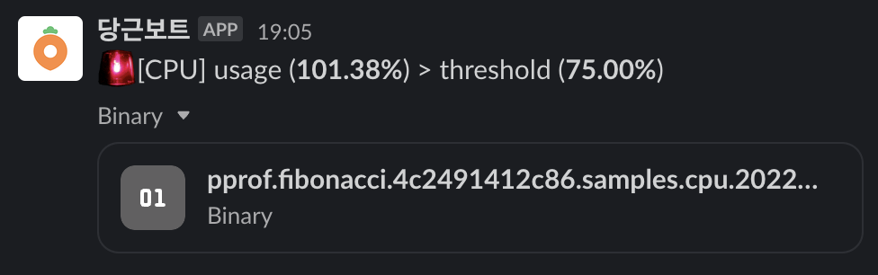
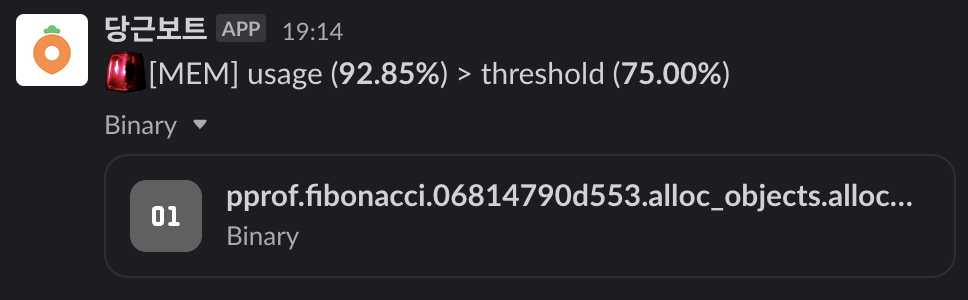

# autopprof

 [](https://github.com/daangn/autopprof/releases)

Automatically profile the Go applications when CPU or memory utilization crosses specific
threshold levels against the Linux container CPU quota and memory limit.

Once you start the autopprof, the autopprof process will periodically check the CPU and
memory utilization of the Go applications. If the resource utilization crosses the
specified threshold for each type of resource, the autopprof will automatically profile
the application (heap or cpu) and report the profiling report to the specific reporter (
e.g. Slack).

| CPU Profile Report Example                                 | Memory Profile Report Example                              |
|------------------------------------------------------------|------------------------------------------------------------|
|  |  |

## Installation

```bash
go get -u github.com/daangn/autopprof/v3
```

## Usage

> If your application is running on non-linux systems, you should check the
> ErrUnsupportedPlatform error returned from `autopprof.Start()` and handle it properly.

```go
package main

import (
	"errors"
	"log"
	"time"

	"github.com/daangn/autopprof/v3"
	"github.com/daangn/autopprof/v3/report"
)

func main() {
	err := autopprof.Start(autopprof.Option{
		App:            "YOUR_APP_NAME",
		CPUThreshold:   0.8,              // Default: 0.75.
		MemThreshold:   0.8,              // Default: 0.75.
		WatchInterval:  10 * time.Second, // Default: 5s. How often each metric is sampled.
		ReportCooldown: 5 * time.Minute,  // Default: 1m. Min gap before re-reporting the same metric.
		Reporter: report.NewSlackReporter(
			&report.SlackReporterOption{
				Token:     "YOUR_TOKEN_HERE",
				ChannelID: "REPORT_CHANNEL_ID",
			},
		),
	})
	if errors.Is(err, autopprof.ErrUnsupportedPlatform) {
		// You can just skip the autopprof.
		log.Println(err)
	} else if err != nil {
		log.Fatalln(err)
	}
	defer autopprof.Stop()

	// Your code here.
}
```

> You can create a custom reporter by implementing the `report.Reporter` interface.

## Custom metrics

Beyond the built-in CPU / memory / goroutine watchers, you can register your own
`Metric` — useful for domain signals that only the owning struct knows about
(connection-pool usage, queue backlog, cache hit ratio, …).

```go
type Pool struct { /* ... */ }

func (p *Pool) Name() string            { return "db_pool" }
func (p *Pool) Threshold() float64      { return 0.9 }
func (p *Pool) Interval() time.Duration { return 10 * time.Second } // 0 → global watchInterval
func (p *Pool) Query() (float64, error) { return p.Usage(), nil }
func (p *Pool) Collect(v float64) (autopprof.CollectResult, error) {
    snap, err := p.Snapshot()
    if err != nil {
        return autopprof.CollectResult{}, err
    }
    return autopprof.CollectResult{
        Reader:   bytes.NewReader(snap),
        Filename: fmt.Sprintf("db_pool_%d.dump", time.Now().Unix()),
        Comment:  fmt.Sprintf(":rotating_light:[pool] %.2f ≥ 0.90", v),
    }, nil
}

// After autopprof.Start(...) — typically inside the struct's constructor:
_ = autopprof.Register(pool)
defer autopprof.Unregister("db_pool")
```

For one-off hooks you can skip the custom type entirely:

```go
_ = autopprof.Register(autopprof.NewMetric(
    "goroutine_blocked", 100, 5*time.Second,
    func() (float64, error)                        { return float64(runtime.NumGoroutine()), nil },
    func(v float64) (autopprof.CollectResult, error) { /* ... */ },
))
```

The names `cpu`, `mem`, and `goroutine` are reserved for the built-in metrics.
User metrics do **not** participate in the built-in cascade.

A built-in breach reports every other enabled built-in in addition to the
triggering one. Set `DisableCPUProf`, `DisableMemProf`, or
`DisableGoroutineProf` to opt a built-in out — it leaves the watcher and
the cascade in one step.

## Event-triggered metrics

Polling is too late for signals that are *events*, such as a bulkhead or
circuit breaker tripping: the trip sheds load immediately, so by the next
tick there is nothing left to profile. Implement `EventMetric` to report
the moment it happens:

```go
type Bulkhead struct {
    // ...
    events chan float64 // make(chan float64, 1)
}

func (b *Bulkhead) Events() <-chan float64 { return b.events }

// Called on the request path when the bulkhead trips.
func (b *Bulkhead) onTrip(ratio float64) {
    select {
    case b.events <- ratio:
    default: // a report is already pending; never block the request
    }
}
```

- A received value is passed to `Collect` on the metric's watcher
  goroutine as-is (no threshold check). `Query` keeps running on its
  ticker as before.
- Events are debounced by `ReportCooldown` on their own clock: ticks
  below the threshold don't re-arm them, and an event report doesn't
  delay the next ticker report.
- Events that arrive while `Collect` is running collapse into the
  channel buffer and are then dropped by the cooldown.
- Closing the channel turns the metric back into a plain polled `Metric`.

## Flight recorder

`Option.FlightRecorder` keeps a
[`runtime/trace.FlightRecorder`](https://pkg.go.dev/runtime/trace#FlightRecorder)
running for the life of the process, so a `Collect` can attach the
execution trace of the seconds *before* it fired:

```go
err := autopprof.Start(autopprof.Option{
    // ...
    FlightRecorder: &autopprof.FlightRecorderOption{
        MinAge:   time.Minute,
        MaxBytes: 64 << 20,
    },
})

func (b *Bulkhead) Collect(v float64) (autopprof.CollectResult, error) {
    var buf bytes.Buffer
    // Snapshot first: anything slower (e.g. a goroutine dump) lets the
    // ring keep overwriting the moments before the trip.
    if _, err := autopprof.WriteTrace(&buf); err != nil {
        return autopprof.CollectResult{}, err
    }
    return autopprof.CollectResult{Reader: &buf, Filename: "bulkhead.trace.out"}, nil
}
```

- Only one flight recorder may run per process, so `Start` fails if
  another one is already active. Use `WriteTrace` instead of starting
  your own.
- Concurrent `WriteTrace` calls are serialized; the stdlib would reject
  the overlapping ones. It returns `ErrFlightRecorderDisabled` when the
  option is nil, before `Start`, after `Stop`, and on non-Linux
  platforms.
- The window ends at whichever limit is hit first: `MinAge` of history,
  or `MaxBytes`. Size `MaxBytes` as your process's trace rate (bytes of a
  10 s `/debug/pprof/trace` ÷ 10) × the lookback you want. The
  [benchmark](#benchmark) shows how rate and CPU cost grow with
  goroutine activity.
- Open a snapshot with `go tool trace`.

## Migrating from v1 to v3

v3 unifies CPU / Mem / Goroutine / Custom under a single `Metric` interface
and narrows the `Reporter` surface. This section lists every change a v1
caller needs to make.

### 1. Update the module path

```diff
- import "github.com/daangn/autopprof"
+ import "github.com/daangn/autopprof/v3"
```

Update `go.mod`:

```bash
go get github.com/daangn/autopprof/v3
```

### 2. `Option` changes

| v1 | v3 |
|---|---|
| `ReportBoth bool` | **Removed.** Cascade is always on for enabled built-ins. |
| `ReportAll bool`  | **Removed.** Cascade is always on for enabled built-ins. |
| *(n/a)* | `App string` — the `"<app>"` segment of built-in filenames. Defaults to `"autopprof"` when empty. |
| *(n/a)* | `Metrics []Metric` — user-defined metrics to register at `Start`. |

All other fields (`CPUThreshold`, `MemThreshold`, `GoroutineThreshold`,
`Disable*Prof`, `Reporter`) are unchanged. Disable individual built-ins
via `Disable*Prof` — they're excluded from the cascade as well.

```diff
 autopprof.Start(autopprof.Option{
+    App:          "YOUR_APP_NAME",
     CPUThreshold: 0.8,
-    ReportBoth:   true,
     Reporter:     myReporter,
 })
```

### 3. `SlackReporterOption` changes

```diff
 report.NewSlackReporter(&report.SlackReporterOption{
-    App:       "YOUR_APP_NAME",   // moved to Option.App
     Token:     "YOUR_TOKEN_HERE",
-    Channel:   "old-channel-name", // removed; Slack API dropped channel-name uploads
     ChannelID: "REPORT_CHANNEL_ID",
 })
```

### 4. `Reporter` interface (4 methods → 1)

```diff
-type Reporter interface {
-    ReportCPUProfile(ctx context.Context, r io.Reader, ci CPUInfo) error
-    ReportHeapProfile(ctx context.Context, r io.Reader, mi MemInfo) error
-    ReportGoroutineProfile(ctx context.Context, r io.Reader, gi GoroutineInfo) error
-}
+type Reporter interface {
+    Report(ctx context.Context, r io.Reader, info ReportInfo) error
+}
+
+type ReportInfo struct {
+    MetricName string  // "cpu", "mem", "goroutine", or user-defined name
+    Filename   string
+    Comment    string
+    Value      float64
+    Threshold  float64
+}
```

Custom `Reporter` implementations should route on `info.MetricName`:

```go
func (r *MyReporter) Report(ctx context.Context, reader io.Reader, info report.ReportInfo) error {
    switch info.MetricName {
    case "cpu":
        return r.sendCPU(ctx, reader, info.Value*100, info.Threshold*100)
    case "mem":
        return r.sendMem(ctx, reader, info.Value*100, info.Threshold*100)
    case "goroutine":
        return r.sendGoroutine(ctx, reader, int(info.Value), int(info.Threshold))
    default:
        return r.sendCustom(ctx, reader, info)
    }
}
```

Removed types from the `report` package: `CPUInfo`, `MemInfo`, `GoroutineInfo`,
`CPUProfileFilenameFmt`, `HeapProfileFilenameFmt`, `GoroutineProfileFilenameFmt`.

### 5. Bug fixes carried in v3

- `Option.DisableGoroutineProf` was silently ignored in v1 (the value
  wasn't assigned to the internal struct at `Start` time). It now takes
  effect correctly, which may change observed behavior for callers
  relying on the flag.
- Cascade (the v1 `ReportAll: true` behavior) is now unconditional for
  enabled built-ins; use `Disable*Prof` to opt specific metrics out.

### 6. New: custom metrics

v3 lets you register your own `Metric`. See the **Custom metrics** section
above — this is the main reason to migrate.

## Benchmark

`./benchmark.sh` runs the benchmarks in a Linux container with the Go
version from `go.mod`, limited to `--cpus=1.5 -m=1000m`. Extra arguments
go to `go test`:

```bash
./benchmark.sh                                   # everything, -benchtime=10s
./benchmark.sh -bench FlightRecorder -count 6 -benchtime 2s
```

The results below are Go 1.26.10 on linux/arm64 (Docker Desktop on an
Apple Silicon Mac), `-count=6 -benchtime=2s`, shown as benchstat medians
± 95% CI. The `-2` suffix is GOMAXPROCS: since Go 1.25 the runtime
derives it from the cgroup CPU limit (1.5 → 2) instead of the host core
count.

### Watching

Sampling the cgroup or the goroutine count every 5s doesn't measurably
change a workload. The ~29 ns on `LightJob` is the benchmark loop's own
`select` on the ticker, paid every iteration and not by autopprof.

| Job | bare | + watch CPU | + watch Mem | + watch Goroutine |
|---|---:|---:|---:|---:|
| `LightJob` (`fib(10)`) | 118.5 ns | 147.6 ns | 146.7 ns | |
| `HeavyJob` (`fib(24)`) | 99.97 µs | 99.61 µs | 99.12 µs | |
| `LightAsyncJob` (`fibAsync(10)`) | 20.18 µs | | | 20.29 µs |
| `HeavyAsyncJob` (`fibAsync(24)`) | 17.56 ms | | | 17.71 ms |

### Flight recorder

The cost of `Option.FlightRecorder` (`MinAge: 1m, MaxBytes: 64 MiB`)
depends on **scheduler events, not CPU**. Each goroutine lifecycle
(create, start, block, unblock, exit) costs about 115–145 ns and 20–40
trace bytes. Code that rarely spawns or parks goroutines pays nothing.

`BenchmarkFlightRecorderOverhead` (`benchstat -col /fr`):

| Job | Goroutines/op | off | on | Δ |
|---|---:|---:|---:|---:|
| `Heavy`: `fib(24)`, CPU only | 0 | 99.26 µs | 99.77 µs | ~ (p=0.485) |
| `FanOut40`: 40 goroutines × `fib(18)`, like an errgroup handler | 40 | 165.6 µs | 169.6 µs | ~ (+2.4%, p=0.093) |
| `LightAsync`: `fibAsync(10)` | 88 | 22.95 µs | 33.07 µs | **+44%** |
| `HeavyAsync`: `fibAsync(24)` | 75k | 17.20 ms | 27.89 ms | **+62%** |

`fibAsync` does nothing but spawn and wait, so it is the worst case. A
real server sits between `FanOut40` and `LightAsync`, depending on how
much work each goroutine does between parks. Estimate your own cost as
roughly *goroutine lifecycles per second × 130 ns*, and confirm it in
production.

`BenchmarkTraceRate` gives the trace bytes produced, which determines how
far back the window reaches: **window ≈ min(MinAge, MaxBytes ÷ rate)**.

| Job | trace-B/op | trace rate | 64 MiB lasts |
|---|---:|---:|---:|
| `Heavy` | 1.4 B | 0.013 MiB/s | MinAge-bound |
| `FanOut40` | 793 B | 4.6 MiB/s | ~14 s |
| `LightAsync` | 3.4 KiB | 87 MiB/s | ~0.7 s |
| `HeavyAsync` | 2.9 MiB | 86 MiB/s | ~0.7 s |

`BenchmarkWriteTrace` takes a snapshot of a full ring while a `FanOut40`
loop keeps writing to it. `sink=discard` is the freeze: the flush and the
ring copy, after which the window can no longer be overwritten.
`sink=buffer` adds copying the bytes into a `bytes.Buffer`.

| MaxBytes | snapshot | freeze (`sink=discard`) | to memory (`sink=buffer`) |
|---|---:|---:|---:|
| 4 MiB | 4.0 MiB | 114 µs | 301 µs |
| 16 MiB | 16.1 MiB | 205 µs | 1.03 ms |
| 64 MiB | 63.7 MiB | 262 µs | 2.86 ms |

### Event trigger

| Benchmark | Result |
|---|---:|
| `BenchmarkEventTrigger`: `Events()` send → `Collect` running | 270 ns |
| `BenchmarkEventNotify`: non-blocking send on a full 1-slot channel, `RunParallel` | 1.3 ns, 0 allocs |

A polled `Query` waits on average half the watch interval (2.5 s at the
default 5 s) before `Collect` starts. An `EventMetric` starts `Collect`
in under a microsecond, and with `WriteTrace` first the window is frozen
about 0.3 ms after the event.

## License

[Apache 2.0](LICENSE)
